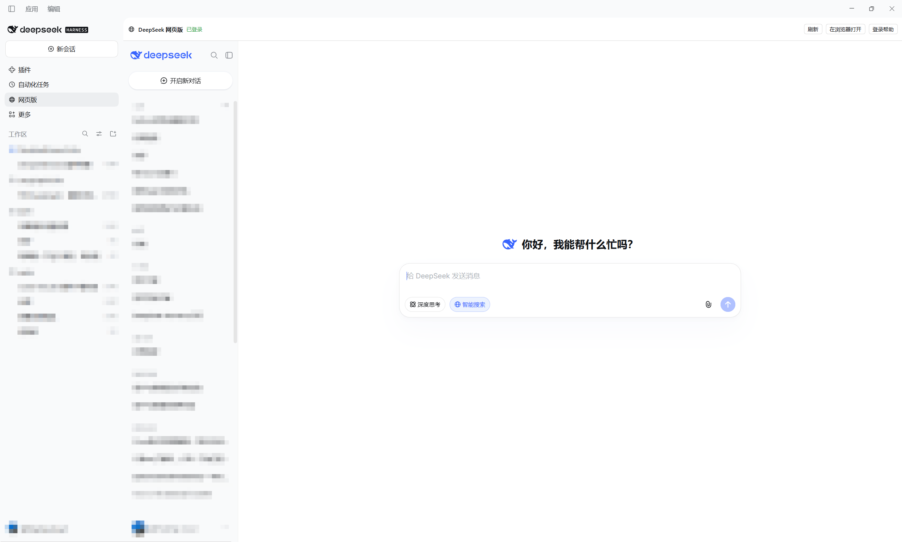

# dsh-deepseek-web-panel

[](https://www.npmjs.com/package/dsh-deepseek-web-panel)
[](./LICENSE)

把 **chat.deepseek.com 网页版**当作一个面板嵌进 [DeepSeek Harness](https://github.com/deepseek-ai/deepseek-harness)：
左侧栏点「网页版」，主区域就是完整的网页版界面，聊过的会话、登录状态都在。



> 这不是官方插件。它把你自己账号的网页版页面装进 Harness，行为和你用浏览器打开一样。

## 特性

- **一个入口**：左侧栏「网页版」，主区域整页嵌入，不破坏 Harness 原有结构。
- **登录一次就够**：像普通网站一样用手机号登录，登录态由本机保存，重开 Harness 仍然有效。
- **记得你看到哪**：切回 Harness 会话再回来，仍在原来那段对话，不会退回首页。
- **不消耗 API 额度**：驱动的是网页版账号本身的会话，与 API Key 无关。
- **纯本地**：代理只监听 `127.0.0.1`，Cookie 和登录凭据只写到 `~/.dsh/deepseek-web-panel/`。

## 安装

**方式一：插件页面（推荐）**

Plugins → Add plugin → 填入本仓库地址或本地目录 → 安装后启用 → 重启 `dsh web`（或重载窗口）。

**方式二：命令行（npm 发布后）**

```sh
dsh plugin --profile web add dsh-deepseek-web-panel
```

**方式三：直接用 GitHub 源码**

```sh
dsh plugin --profile web add github:<你的账号>/dsh-deepseek-web-panel
```

## 在 DSH 里发现它

在 **Plugins → Discover → Add index source** 添加本仓库的插件索引：

```text
https://cwx2.github.io/dsh-deepseek-web-panel/index.json
```

之后就能在 Discover 里搜到并一键安装。（需要仓库启用 GitHub Pages，见 `RELEASING.md`。）

## 使用

1. 左侧栏点「网页版」。
2. 首次打开会看到登录页，输入手机号 → 获取验证码 → 登录。
3. 之后每次打开都直接进入已登录状态，并回到上次的对话。

> **微信扫码为什么用不了**：微信 OAuth 只认白名单域名（`chat.deepseek.com`），面板运行在
> 本机回环地址上，必然被拒绝。手机号登录进入的是同一个账号。右上「登录帮助」里有同样的说明。

## 工作原理

```
Harness 主窗口
└── 左侧栏「网页版」入口（sidebar.panellist）
    └── 主区域面板（main，keyed slot）
        └── iframe → http://127.0.0.1:3098/    ← Host 回环代理
                       └── https://chat.deepseek.com
```

代理做四件事：

1. **改写资源地址**：把 `fe-static.deepseek.com` 的静态资源经本机转发，并给入口脚本打补丁；
2. **允许嵌入**：剥掉 `Content-Security-Policy`、`X-Frame-Options`；
3. **保存登录**：`Set-Cookie` 收进 Host 侧的 jar（`cookies.json`），跨重启保留；
4. **保持身份与位置**：在页面脚本执行前注入一段启动脚本，负责
   UA 规范化（去掉 `Electron` 标记）、登录 token 回填与捕获、以及当前 URL 上报（`route.json`）。

## 配置

| 环境变量 | 默认值 | 说明 |
| --- | --- | --- |
| `DSH_DEEPSEEK_WEB_PANEL_PORT` | `3098` | 回环代理端口；被占用时自动换空闲端口 |
| `DSH_DEEPSEEK_WEB_PANEL_STATE` | `$DSH_HOME/deepseek-web-panel` | Cookie、登录态、位置文件的目录 |
| `DSH_DEEPSEEK_WEB_PANEL_DEBUG=1` | 关 | 打印上游请求日志（不含凭据） |

## 已知限制

- 只对桌面版（Desktop）有效；纯 headless 组合没有 `webServer`，面板不会出现。
- 微信扫码、Apple 登录不可用（OAuth 回调域名限制），请用手机号。
- 网页版改版可能导致 `src/transform.js` 里的补丁失效；Host 日志会打印
  `entry bundle patterns missing: ...`，按新文本更新即可。
- 在面板里「退出登录」不会清除已保存的凭据；换账号请删除 `session.json` 后重新登录。
- 请遵守 DeepSeek 服务条款，不要高频或并发驱动网页端；发给网页端的内容会离开本机。

## 隐私

- 代理只绑定回环地址，不对局域网开放。
- Cookie、登录凭据、位置文件都保存在 `~/.dsh/deepseek-web-panel/`，其中凭据文件权限为 `0600`。
- 插件不上报任何遥测；对话内容不经过除 DeepSeek 官方之外的第三方。

## 开发

```sh
git clone https://github.com/<你的账号>/dsh-deepseek-web-panel.git
cd dsh-deepseek-web-panel
```

把本地目录加进 profile 后即可联调：

```sh
dsh plugin --profile web add /绝对路径/dsh-deepseek-web-panel
```

调试循环：

- **前端改动**：窗口内 `F12` → Console → `location.reload()`（生产版没有 Ctrl+R）。
- **Host 改动**：Plugins 页面把插件开关关掉再打开，等价于重新加载模块，无需重启整个应用。
- **路由自检**：`curl http://127.0.0.1:3126/plugins/deepseek-web-panel/status`。

目录结构：

```
index.js              Host 半边入口：装配代理、注册同源路由
client.js             浏览器半边：左栏入口 + main 面板 + 登录帮助
cordis.patch.yml      Host 行插入
src/proxy.js          代理装配与路由分派
src/forward.js        资源改写、页面注入、流式转发
src/transform.js      入口脚本补丁（随上游改版更新）
src/sync.js           启动脚本生成：UA/token 回填/捕获/位置上报
src/login-store.js    登录态存储（pending + session）
src/route-store.js    最近位置存储
src/cookies.js        Cookie jar
src/http.js           HTTP 小工具
src/websocket.js      WebSocket 升级转发
locale/               插件列表里的标题与描述
```

## 致谢

`src/` 下的回环代理实现改编自 [dsh-deepseek-chat-panel](https://github.com/KokoTa/dsh-deepseek-chat-panel)（MIT），
本仓库在其基础上重做了包结构、Host 路由和左侧栏面板交互。详见 [LICENSE](./LICENSE)。

## License

MIT
